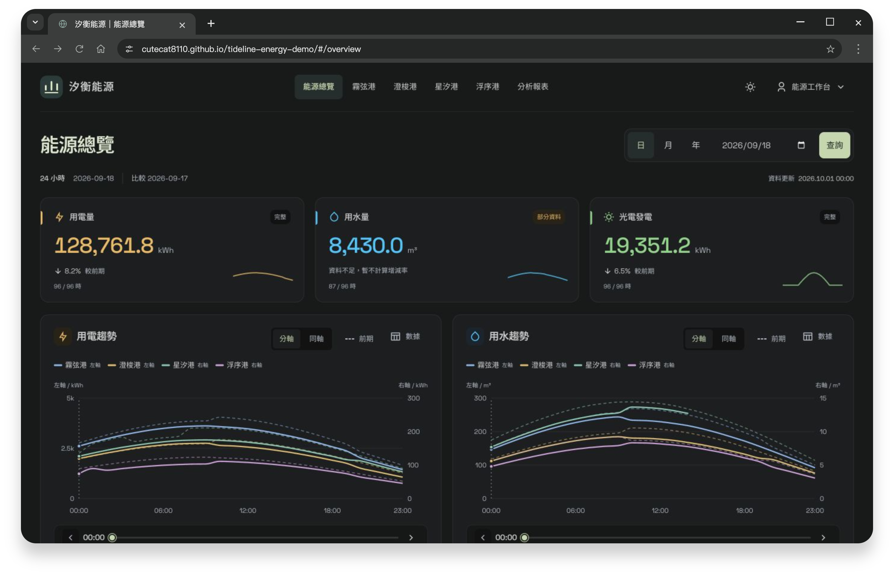
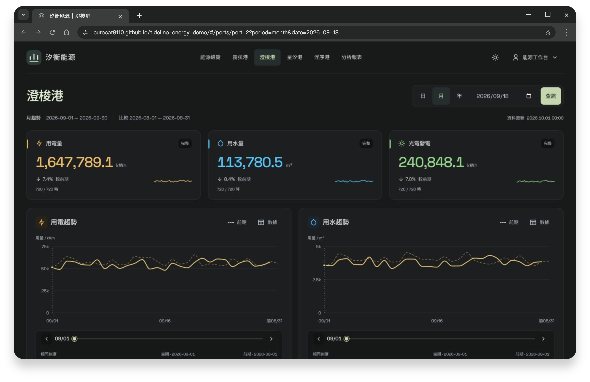
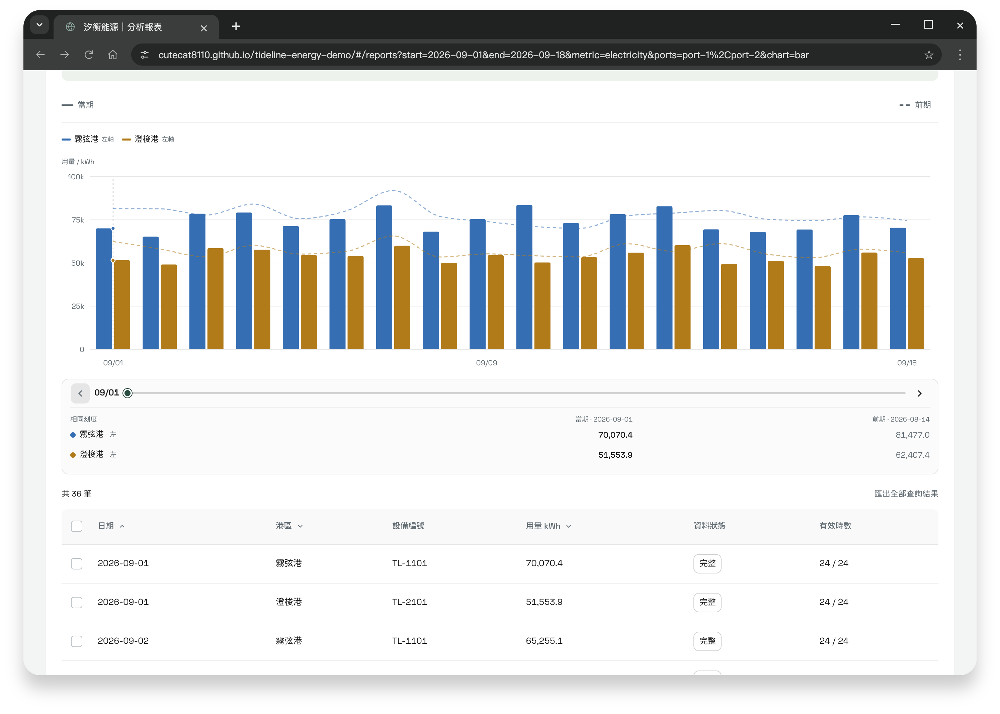

# 能源儀表板

`React 19` · `TypeScript` · `Recharts` · `Base UI` · `Vite`

四港能源趨勢與雙刻度比較，支援前期分析及報表匯出。

**[開啟 Demo](https://cutecat8110.github.io/tideline-energy-demo/)**

| 入口 | 代表操作 |
| --- | --- |
| [能源總覽](https://cutecat8110.github.io/tideline-energy-demo/#/overview) | 用電、用水、光電摘要；四港分軸／同軸比較 |
| [港區趨勢](https://cutecat8110.github.io/tideline-energy-demo/#/ports/port-2?period=month&date=2026-09-18) | 日／月／年、前期虛線、時段定位與明細 |
| [分析報表](https://cutecat8110.github.io/tideline-energy-demo/#/reports) | 三種圖表、五組查詢保存、CSV 與列印 |

**試用：** 點鑰匙帶入帳密 → 比較四港曲線 → 切換同軸／分軸 → 查詢並匯出報表。

港區趨勢與分析報表

實作重點

圖表、明細與匯出共用資料計算；缺值不補零。支援鍵盤定位、亮暗主題及響應式版面。查詢草稿與套用條件分離，IndexedDB 保存條件並處理版本衝突。

使用說明

品牌、港區、設備與數據均為合成；資料期間為 2024/01/01–2026/09/30，更新時間固定為 2026/10/01。沒有即時量測、正式身分驗證或外部服務。

條件與外觀保存在目前瀏覽器；「重設資料」清除並登出，不影響其他作品。4K 僅完成瀏覽器尺寸驗證，未測試實體電視牆。

